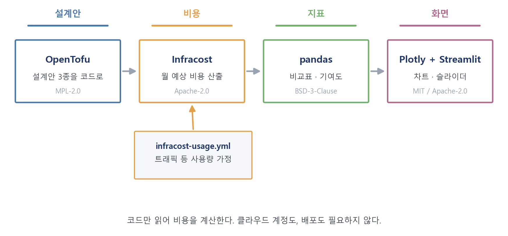
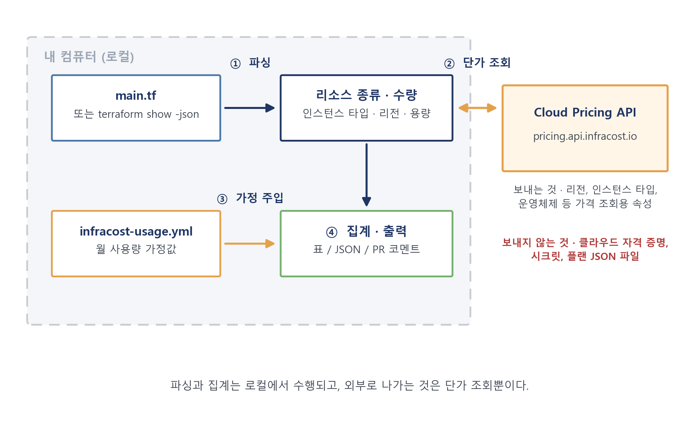
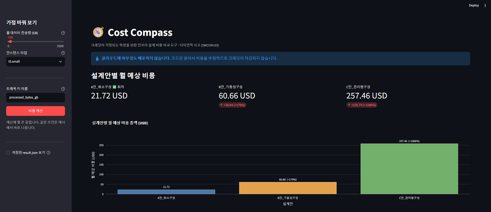
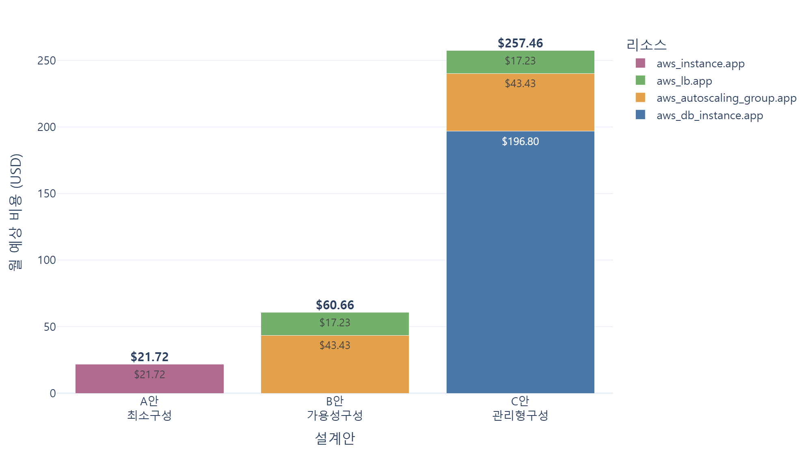
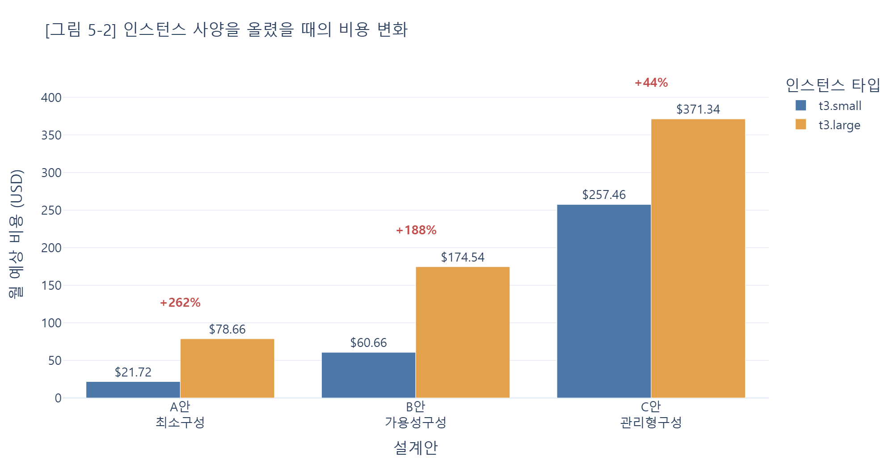
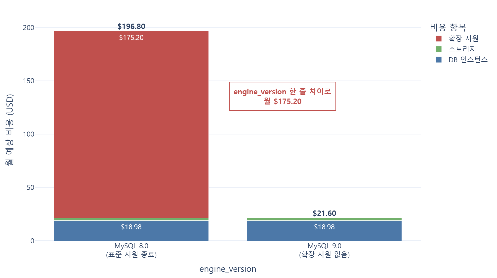

# Cost Compass

**크레딧이 걱정되는 학생을 위한 인프라 설계 비용 비교 도구**

배포하기 전에, AWS 인프라 설계안 여러 개의 월 예상 비용을 같은 조건에서 비교한다.
클라우드 계정도, 자격 증명도, 실제 배포도 필요하지 않다. 따라서 **크레딧이 차감되지 않는다.**

> 경희대학교 소프트웨어융합학과 · 디자인적 사고(SWCON103) 중간 레포트
> "메이커 운동과 오픈소스 활용하기 — 오픈소스에 새로운 의미를 부여하라"

---

## 왜 만들었나

클라우드는 쓴 만큼 돈을 내는 구조라, **얼마를 쓰게 될지 미리 알기 어렵다.**

학생에게는 이 문제가 더 무겁다. 교육용 크레딧은 한도가 정해져 있고, 한 번 차감되면 되돌릴 수 없으며, 다 쓰면 남은 학기 실습이 막힌다. 그래서 학생은 리소스를 고를 때마다 "이걸 켜면 얼마나 깎일지 모른다"는 불안을 안고 선택하고, 그 불안은 **과도하게 보수적인 선택**으로 이어진다. 더 좋은 사양을 한 번 써 보면 배울 수 있는데도 겁이 나서 가장 작은 것만 고르고, 로드 밸런서와 오토 스케일링처럼 여러 리소스가 함께 켜지는 구성은 아예 시도하지 못한다.

**학생이 비용을 몰라서 잃는 것은 돈이 아니라 배울 기회다.**
그러니 필요한 것은 "비용을 아껴 주는 도구"가 아니라, **얼마가 나올지 미리 알려 주어 안심하고 선택하게 해 주는 도구**다.

### 풀어야 했던 모순

| 특성: 설계안의 구체성 | (a) 구체적이어야 한다 | (−a) 구체적이지 않아야 한다 |
|---|---|---|
| 이유 | 비용을 계산하려면 인스턴스 타입·개수·리전이 다 정해져야 한다 | 여러 안을 비교하는 단계이므로 아직 확정하지 않은 상태다 |

> 비용을 알려면 설계를 확정해야 하고, 설계를 확정하려면 비용을 알아야 한다.

TRIZ의 **시간 분리**와 **공간 분리**로 풀었다. 구체화를 비교 시점보다 **앞으로 옮겨** 설계안을 미리 코드로 만들어 두면, 계산기에게는 완전히 구체적이면서 사용자에게는 아직 확정되지 않은 상태가 동시에 성립한다. 미리 정할 수 없는 트래픽은 사용량 파일로 따로 빼낸다.

도출 과정 전체는 [docs/report.md](docs/report.md)에 있다.

---

## 어떻게 만들었나

다섯 개의 오픈소스를 **설계안에서 화면까지 이어지는 한 줄기**로 연결했다.



| 오픈소스 | 역할 | 라이선스 |
|---|---|---|
| [OpenTofu](https://github.com/opentofu/opentofu) | 설계안 3종을 코드로 선언 | MPL-2.0 |
| [Infracost](https://github.com/infracost/infracost) | 코드를 읽어 월 예상 비용 산출 | Apache-2.0 |
| [pandas](https://github.com/pandas-dev/pandas) | JSON을 설계안×비용 비교표로 | BSD-3-Clause |
| [Plotly](https://github.com/plotly/plotly.py) | 비용 구성을 차트로 | MIT |
| [Streamlit](https://github.com/streamlit/streamlit) | 트래픽 슬라이더로 직접 조작 | Apache-2.0 |

Infracost는 클라우드 계정에 접속하지 않고 **코드만 로컬에서 파싱**해 비용을 계산한다. 외부로 나가는 것은 단가 조회뿐이다.



**새롭게 의미를 부여한 지점:** Infracost는 원래 실무 엔지니어가 **이미 작성한 코드의 비용 변화를 통제**하는 도구다. 이 프로젝트는 사용자를 *크레딧으로 실습하는 학생*으로, 사용 시점을 *설계 확정 이전*으로 옮겨, **아직 정하지 않은 설계를 고르는** 도구로 바꾸었다.

---



왼쪽 슬라이더로 트래픽과 인스턴스 타입을 바꾸면 세 설계안의 비용이 즉시 다시 계산된다. 설계안 코드는 그대로 두고 **사용량 가정만** 바꾸는 구조다.

---

## 비교한 설계안

같은 웹 서비스를 올린다고 가정하고, 가용성 수준만 다르게 했다.

| | A안 · 최소 구성 | B안 · 가용성 구성 | C안 · 관리형 구성 |
|---|---|---|---|
| 컴퓨팅 | EC2 1대 | ALB + Auto Scaling (2대) | ALB + Auto Scaling (2대) |
| 데이터베이스 | 인스턴스 내 설치 | 인스턴스 내 설치 | RDS 분리 |
| 특징 | 저렴하나 단일 장애점 | 서버 이중화 | 운영 부담 최소 |

리전·AMI·인스턴스 타입·볼륨 크기는 셋 다 같은 값으로 맞췄다. 달라지는 것은 구성뿐이다.

---

## 측정 결과

**측정 조건** · Infracost v0.10.47 · ap-northeast-2(서울) · 월 730시간 · 데이터 전송 100GB · t3.small · MySQL 8.0

| 설계안 | 월 예상 비용 | A안 대비 | 비용 1위 리소스 | 1위 비중 |
|---|---|---|---|---|
| A안 | $21.72 | 기준 | `aws_instance.app` | 100.0 % |
| B안 | $60.66 | +$38.94 (+179.3 %) | `aws_autoscaling_group.app` | 71.6 % |
| C안 | $257.46 | +$235.74 (+1085.6 %) | `aws_db_instance.app` | 76.4 % |



### 가용성의 가격은 서버 한 대 값이 아니다

A안에서 B안으로 가면 월 $38.94가 는다. "서버가 1대에서 2대가 되니 두 배"일 것 같지만 실제로는 **2.79배**다. 인스턴스 추가분은 $18.98뿐이고 나머지 $17.23은 로드 밸런서 요금이다. 가용성의 비용은 서버 대수가 아니라 **트래픽을 나누는 장치**에서 더 크게 발생한다.

### 사양을 올리면 얼마나 늘어나는가

"겁이 나서 가장 작은 사양만 골랐다"는 상황을 그대로 실험했다.

| 설계안 | t3.small | t3.large | 증가율 |
|---|---|---|---|
| A안 | $21.72 | $78.66 | +262.2 % |
| B안 | $60.66 | $174.54 | +187.7 % |
| C안 | $257.46 | $371.34 | +44.2 % |



증가액은 B안과 C안이 $113.88로 같은데 증가율은 187.7 %와 44.2 %로 크게 다르다. 이미 다른 데서 큰 비용이 나가고 있으면 같은 변경이 작아 보인다. 그래서 총액과 **리소스별 기여도**를 항상 함께 보여 준다.

---

## 만들다가 걸린 것 — `engine_version` 한 줄에 월 $175

C안의 비용 1위 리소스를 들여다보다가 의도하지 않은 항목을 발견했다.
RDS 비용 $196.80 가운데 **$175.20이 확장 지원(Extended Support) 요금**이었다. 표준 지원이 끝난 엔진 버전을 쓰면 AWS가 따로 부과하는 요금이다.

| 항목 | MySQL 8.0 | MySQL 9.0 | 차이 |
|---|---|---|---|
| DB 인스턴스 (db.t3.micro) | $18.98 | $18.98 | — |
| 스토리지 (gp3 20GB) | $2.62 | $2.62 | — |
| 확장 지원 (year 1) | $175.20 | 없음 | −$175.20 |
| **RDS 소계** | **$196.80** | **$21.60** | **−$175.20** |
| **C안 총액** | **$257.46** | **$82.26** | **−$175.20** |



코드에서 달라지는 건 문자열 한 줄인데 DB 인스턴스 자체 요금의 **9.2배**가 차이 난다.

이 발견이 중요한 이유는 따로 있다. 이걸 모른 채 설계했다면 *"관리형 DB는 너무 비싸니 쓰지 말자"* 는 **잘못된 결론**에 도달했을 것이다. 엔진 버전만 바꾸면 C안은 B안 대비 35.6 % 증가에 그친다.

> **문제는 선택지가 비싼 것이 아니라, 무엇이 비싼지를 몰랐다는 데 있었다.**

이 도구가 가정한 사용자(아무것도 모르고 겁먹는 학생)가 만든 사람 자신이었던 셈이다.

---

## 직접 돌려 보기

```bash
# 0. Infracost 설치 후 무료 API 키 발급 (AWS 계정은 필요 없음)
infracost auth login

# 1. 파이썬 의존성
pip install -r requirements.txt

# 2. 설계안 3종 비용 산출
infracost breakdown --config-file infracost.yml --format json --out-file result.json

# 3. 비교표 (보고서 표 5-3 형태의 마크다운으로 출력)
python analyze.py result.json

# 4. 그림 생성 — 측정 결과 차트 3장, 구조 다이어그램 2장
python make_figures.py
python make_diagrams.py

# 5. 화면 띄우기
streamlit run app.py
```

자세한 단계와 실험 방법은 [docs/HOWTO.md](docs/HOWTO.md)에 있다.

> PowerShell에서는 `&&` 대신 `;` 로 명령을 잇는다.

### 구성

```
.
├── design-a/ design-b/ design-c/   설계안 3종 (HCL)
├── infracost.yml                   세 설계안을 같은 가정으로 비교
├── infracost-usage.yml             공통 사용량 가정 (트래픽 등)
├── infracost-large.yml             실험: t3.large
├── infracost-db-supported.yml      실험: 확장 지원 없는 엔진 버전
├── analyze.py                      JSON → 비교표
├── charts.py / make_figures.py     측정 결과 차트
├── make_diagrams.py                구조 다이어그램
├── app.py                          Streamlit 화면
├── result*.json                    실제 측정 결과 (재현 검증용)
├── figure/                         보고서에 쓴 그림 6장
├── main.tex / refer.bib            보고서 조판 소스
└── docs/
    ├── report.md                   보고서 본문
    └── HOWTO.md                    실행 방법 상세
```

---

## 보고서 조판

보고서 PDF를 만드는 소스도 함께 두었다. 결과물만이 아니라 만드는 방법을 공개한다는 뜻이다.

```
main.tex        조판 소스 (표 28개, 그림 6장, 번호 체계, 상호참조)
refer.bib       참고문헌 10건
figure/         본문에 들어가는 그림
docs/report.md  분량을 줄이기 전의 전체 원고 (마크다운)
```

**Overleaf에서 컴파일하려면** 저장소 전체를 zip으로 받아 업로드한다. `main.tex`가 자동으로 메인 문서로 잡힌다. 컴파일러는 **pdfLaTeX**(한글은 `kotex`)이고, 참고문헌이 있으므로 **두 번 이상** 돌려야 번호가 맞는다.

`main.tex` 맨 위의 두 줄은 자리표시자로 두었다. 제출용 PDF를 만들 때만 바꾼다.

```latex
\newcommand{\studentid}{(학번)}
\newcommand{\studentname}{(이름)}
```

## 한계

1. **도구 버전에 따른 가격 데이터 오차.** v0.10.47은 MySQL 9.0 미만을 일괄적으로 확장 지원 대상으로 취급한다(8.0 / 8.4 / 8.4.3 모두 $175.20 부과). 그러나 MySQL 8.4는 LTS로 표준 지원 기간이 남아 있어, 실제 청구에서는 붙지 않을 가능성이 높다. **표의 '차이' 자체는 신뢰할 수 있으나, 어느 버전이 실제 과금 대상인지는 AWS 공식 문서로 교차 확인해야 한다.**
2. **버전 체계 불일치.** CLI는 v2.18.3으로 업데이트하라고 안내하나, 오픈소스 저장소의 릴리스 목록에는 해당 버전이 없고 v0.10.47이 최신이다(2026-10-21 공개).
3. **가정값 민감도.** 사용량 기반 항목은 가정에 따라 달라진다. 세 설계안에 같은 가정을 적용해 **상대적 순서**를 비교한 것이며 절대 금액을 보장하지 않는다. t3 계열의 CPU 크레딧 초과분은 0으로 가정했다.
4. **일부 리소스 미반영.** A안의 `aws_eip`가 비용 0으로 처리되었다. AWS는 2024년 2월부터 사용 중인 공인 IPv4에도 과금하므로 실제로는 비용이 발생할 수 있다.
5. **할인 제도 미반영.** Savings Plans, Reserved Instance, 프리 티어, 교육용 크레딧의 적용 방식은 반영되지 않았다.
6. **설계안 3종의 대표성.** 미리 준비한 템플릿 바깥의 구성은 비교할 수 없다. 시간 분리를 적용하면서 치른 대가다.

---

---

## 왜 공개하는가 — DIY에서 DIT로

메이커 운동의 핵심은 **모든 것을 디지털화**해 설계도·코드·데이터를 파일로 만들고, **기술과 지식을 나누어** 만드는 방법을 공개하고 함께 발전시키는 데 있다. 한 줄로 줄이면 **DIY(Do It Yourself, 혼자 만든다)에서 DIT(Do It Together, 함께 만들고 나눈다)로**의 전환이다.

이 기준에서 보면, 오픈소스 다섯 개를 받아 쓰기만 하고 끝내는 것은 여전히 소비자에 머무는 일이다. 그래서 결과물 전체를 돌려놓았다.

| 구분 | 공개한 이유 |
|---|---|
| 설계안 코드 (`design-*/`) | 같은 비교를 하려는 사람이 처음부터 작성하지 않아도 되게 |
| 설정 파일 (`infracost*.yml`) | 어떤 가정 위에서 나온 숫자인지 드러내려고 |
| 분석 스크립트 (`*.py`) | 결과를 다시 만들어 볼 수 있도록 |
| **측정 결과 원본** (`result*.json`) | **숫자를 주장만 하지 않고 검증할 수 있게** |
| 보고서 (`docs/report.md`) | 결론만이 아니라 도달한 과정을 남기려고 |

측정 결과 JSON을 넣은 것은 의도한 선택이다. 위 표에 적은 숫자가 맞는지 직접 확인할 수 있어야 "결과는 정직하게"라는 요구를 충족한다고 보았다. 한계 역시 숨기지 않고 그대로 적었다.

공개의 의미가 가장 분명해지는 지점은 확장 지원 요금이다. `engine_version` 한 줄 때문에 월 $175가 붙는다는 사실을 모른 채 템플릿을 썼고, 도구를 돌려 보고서야 알았다. 혼자 알고 끝내면 다음 사람이 똑같이 당한다. 코드와 측정 결과를 함께 공개하면 **한 사람이 치른 시행착오가 다음 사람에게는 이미 해결된 출발점**이 된다.

덧붙여 이 프로젝트는 3D 프린터도 별도 장비도 없이 **노트북 한 대로** 만들었다. 필요한 것은 장비가 아니라 무엇을 만들지 정하는 일이었다.

---

## 주의

`design-*/main.tf` 는 **비용 추정 전용**이며 `apply` 하지 않는다. provider 블록에 자격 증명 검증을 건너뛰도록 설정했고, VPC·서브넷 ID는 더미 값이다. 실제 배포에 쓰려면 그대로 쓰지 말고 환경에 맞게 다시 작성해야 한다.

## 라이선스

이 저장소의 코드와 문서는 학습 목적으로 공개한다.
사용한 오픈소스의 라이선스는 위 표와 각 저장소를 따른다.
